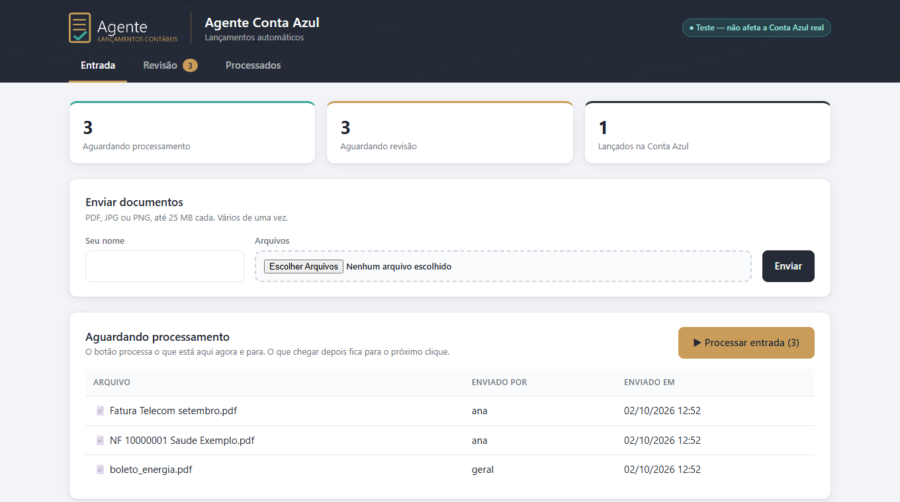
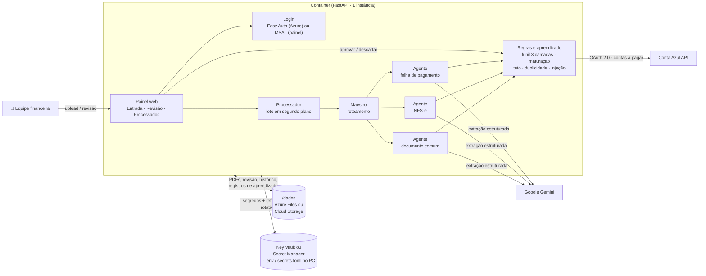
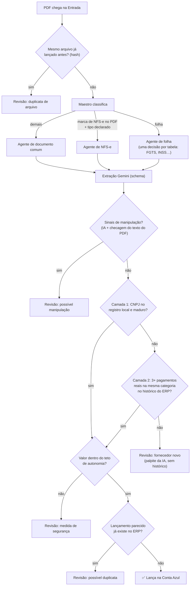
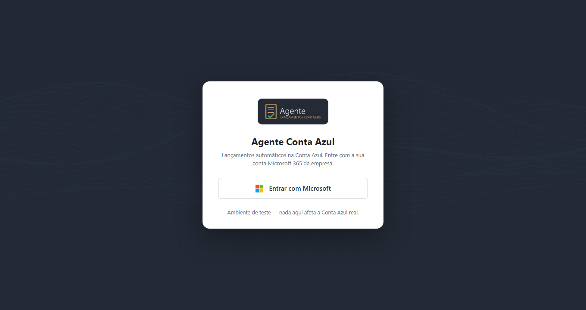
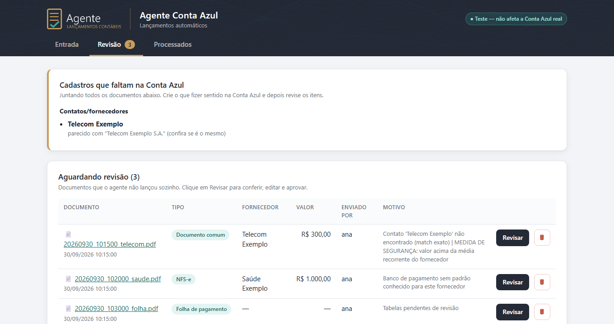
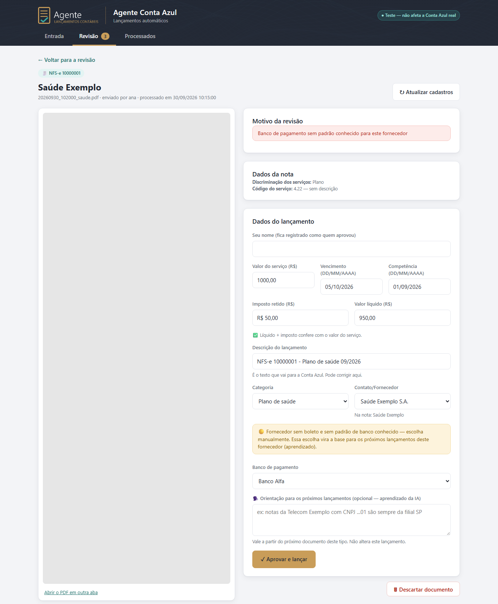
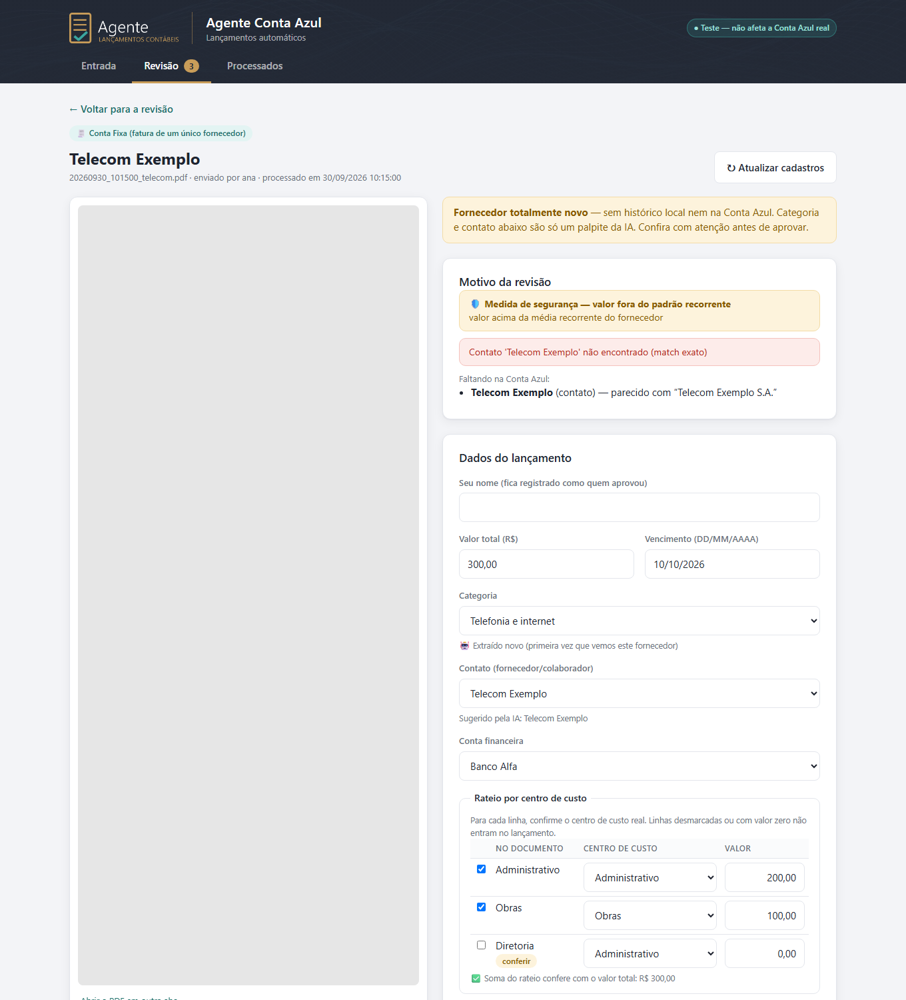
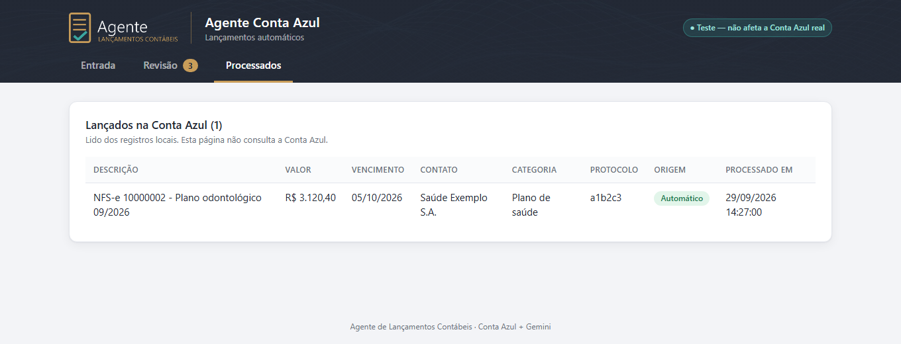

# Agente de Lançamentos Contábeis · Conta Azul + Gemini

> Agente que lê os documentos financeiros de uma empresa (faturas, boletos, NFS-e, folha de pagamento), decide sozinho o que lançar no ERP **Conta Azul** e manda para revisão humana só o que merece um olhar. Tudo isso com regras auditáveis, aprendizado com as aprovações e várias camadas de segurança.




> **Sobre este repositório.** Esta é uma versão **modelo e genérica** de uma solução construída e usada em produção. Nomes de empresa, bancos, fornecedores, pessoas, CNPJs e IDs de conta foram trocados por valores fictícios. As regras de negócio servem como exemplo: adapte-as ao plano de contas e aos fornecedores da sua empresa.

---

## Sumário
- [O problema](#o-problema)
- [O que a solução faz](#o-que-a-solução-faz)
- [Arquitetura](#arquitetura)
- [Como um documento é decidido](#como-um-documento-é-decidido)
- [Segurança em camadas](#segurança-em-camadas)
- [Desafios técnicos superados](#desafios-técnicos-superados)
- [Telas](#telas)
- [Stack](#stack)
- [Como rodar](#como-rodar)
- [Configuração](#configuração)
- [Implantação](#implantação)
- [Testes](#testes)
- [Estrutura do projeto](#estrutura-do-projeto)
- [Próximos passos](#próximos-passos)

---

## O problema

Todo mês o financeiro recebe dezenas de documentos: notas fiscais de serviço, faturas de telecom e energia, boletos, guias de FGTS e INSS, recibos de férias, rescisões, reembolsos de funcionários. Cada um precisa virar um lançamento de contas a pagar no ERP, com **fornecedor, categoria, conta bancária, vencimento, competência e rateio por centro de custo** corretos.

Fazer isso à mão é lento e repetitivo, e o erro custa caro: lançamento duplicado, categoria errada, conta errada, vencimento invertido. Automatizar "às cegas" com IA também é perigoso. Um modelo de linguagem pode inventar campos, e um PDF malicioso pode tentar **instruir a IA** a lançar outro valor.

## O que a solução faz

- 📥 **Recebe os documentos** por upload numa página web. Cada arquivo fica identificado com quem enviou.
- 🧭 **Classifica cada documento**: documento comum, NFS-e ou folha de pagamento. O agente certo processa cada um.
- 🤖 **Extrai os dados com o Gemini** em JSON validado por schema (Pydantic). O documento é tratado como **dado**, nunca como instrução.
- ⚖️ **Decide com regras auditáveis** se pode lançar sozinho ou se precisa de revisão, por um funil em 3 camadas e por um contador de maturação.
- ✅ **Lança na Conta Azul** pela API oficial (OAuth 2.0), com rateio por centro de custo, conta financeira e forma de pagamento.
- 👀 **Mostra numa tela de revisão** o que parou: o PDF ao lado de um formulário já preenchido, com o motivo da revisão destacado e botões de aprovar e descartar.
- 🧠 **Aprende com cada aprovação humana**: fornecedor e categoria por CNPJ, banco de pagamento, centro de custo por funcionário, palavras-chave e orientações livres em texto, que viram contexto para as próximas extrações.
- 🔐 **Tem login Microsoft 365**, registra quem aprovou cada lançamento e funciona igual no PC, no Azure e no Google Cloud.

---

## Arquitetura



**Decisões de arquitetura que valem destaque**

| Decisão | Por quê |
|---|---|
| **Um container, uma instância** | O refresh token da Conta Azul é de **uso único**: duas réplicas renovando ao mesmo tempo derrubariam uma à outra. Uma instância também mantém simples o estado em memória (andamento do lote). |
| **Regras de negócio separadas da tela** (`src/agentes/revisao.py`) | A mesma lógica de aprovação serve ao painel e aos testes, e a tela pode ser trocada sem tocar nas regras. A tela já foi trocada uma vez: de Streamlit para FastAPI. |
| **Estado em arquivos JSON com trava** | O volume é baixo e o estado precisa ser legível e auditável por humanos. Gravação atômica (arquivo temporário + `os.replace`), backup com rotação e trava por arquivo. |
| **Configuração por variáveis, com vários "cofres"** | O mesmo código lê `.env` ou `secrets.toml` no PC, o Key Vault no Azure e o Secret Manager no Google. Nenhuma credencial entra na imagem. |
| **IA só extrai; quem decide são as regras** | O Gemini devolve dados. Lançar ou não é decidido por código determinístico, testável e explicável ao auditor. |

---

## Como um documento é decidido



- **Funil de decisão em 3 camadas.** (1) **Registro local:** o fornecedor já confirmado por humanos, só com autonomia depois de **3 aprovações** (contador de maturação). (2) **Histórico do ERP:** o fornecedor nunca visto localmente, mas com 3+ pagamentos reais já liquidados na mesma categoria, lança já na primeira vez e "pré-matura" a regra. (3) **Fallback da IA:** sem histórico nenhum, nunca lança sozinho, e a tela avisa que a sugestão é só um palpite.
- **Contador de maturação na folha:** cada tipo de lançamento (FGTS, INSS, rescisão, férias…) só ganha autonomia depois de algumas aprovações humanas daquele padrão.
- **Aprendizado em texto livre:** o revisor escreve uma orientação, como "notas deste fornecedor são sempre da filial SP". Ela entra no prompt das próximas extrações e **reextrai na hora** os documentos do mesmo tipo que já aguardavam revisão.
- **Diretrizes por palavra-chave:** em reembolsos, palavras como "uber" ou "hotel" ficam ligadas à categoria, conta e centro de custo aprovados. A tela mostra se cada diretriz foi confirmada por um humano ou só inferida do histórico.

---

## Segurança em camadas

| Ameaça | Defesa |
|---|---|
| **Prompt injection no PDF** (texto branco ou letra miúda mandando a IA trocar valor ou CNPJ) | Duas camadas independentes: o prompt trata o documento como dado e exige que a IA sinalize instruções suspeitas, e uma **checagem determinística** da camada de texto do PDF (`pypdf`) procura frases típicas de injeção. Qualquer sinal tira a autonomia. Validado com PDFs maliciosos fictícios: 100% bloqueados, sem falso positivo em dezenas de documentos reais. |
| **Valor fora do padrão** | **Teto de autonomia** por tipo de documento, calibrado no histórico real. Acima dele, sempre revisão, com o motivo explicado em destaque. Lista de isenção por **CNPJ**, e não por nome, que é fácil de imitar. |
| **Lançamento duplicado** | Duas camadas: o **hash do arquivo**, contra o mesmo PDF reenviado, e uma **busca no ERP** por valor, vencimento, fornecedor e categoria antes de cada lançamento. Para lançar mesmo assim, é preciso um botão de confirmação deliberado, que nunca fica "lembrado". |
| **Retry que duplica** | Escritas na API só são repetidas quando há certeza de que nada foi gravado (falha de conexão, 429). Timeout ou 5xx numa escrita viram "resultado incerto: confira antes de reenviar". |
| **Duas pessoas aprovando o mesmo item** | **Trava por item**: só uma aprovação lança, e a outra recebe "outra pessoa está tratando". Quem aprovou fica no histórico. |
| **Acesso indevido** | Login Microsoft 365: o **Easy Auth** no Azure, ou **MSAL com `state`, `nonce` e PKCE** no próprio painel, restrito ao tenant e opcionalmente a uma lista de e-mails. Na nuvem, sem login, toda página responde 401. **CSRF:** um POST só é aceito com `Origin`/`Referer` do próprio host. |
| **Vazamento de credenciais** | Nenhum segredo no código nem na imagem (`.gitignore`/`.dockerignore`, com testes que garantem isso). Os segredos vêm do Key Vault, do Secret Manager, do `.env` ou do `secrets.toml`. Erros técnicos vão só para o log, nunca para a tela. |
| **Caminho de arquivo malicioso** | O PDF só é servido pelo nome, de pastas permitidas, e o upload usa só o nome do arquivo, nunca um caminho vindo do navegador. |

---

## Desafios técnicos superados

Problemas reais encontrados ao colocar a solução em produção, e como foram resolvidos.

<details open>
<summary><b>1. Refresh token de uso único, rotativo, em vários ambientes</b></summary>

A Conta Azul **invalida o refresh token a cada renovação**. Uma renovação em que o token novo não é persistido derruba a integração até alguém gerar um novo à mão. Isso aconteceu de verdade: um teste de portabilidade renovou o token e o gravou numa pasta temporária, que foi apagada em seguida.

**Solução:** cache compartilhado do access token, com trava de arquivo (`filelock`), para processos concorrentes não renovarem juntos. A persistência do token novo vai sempre para **a mesma origem de onde ele veio**: `.env` ou `secrets.toml` com escrita atômica e preservando os comentários, uma nova versão no **Key Vault** ou uma nova versão no **Secret Manager**, com limpeza automática das versões antigas, porque o Secret Manager cobra por versão ativa. Se a gravação falhar, o token novo continua na memória e o log avisa com urgência.
</details>

<details>
<summary><b>2. Prompt injection: a IA obedecia a texto escondido no PDF</b></summary>

Num teste com PDFs fictícios, a extração de documento comum obedeceu em **3 de 3 tentativas** a uma instrução em texto branco para trocar o valor de R$ 275 por R$ 98.500. Como o CNPJ extraído decide a autonomia, um CNPJ de fornecedor "maduro" injetado herdaria o lançamento automático.

**Solução:** defesa em duas camadas independentes (prompt endurecido com sinalização obrigatória + detector determinístico no texto do PDF). Uma primeira versão do prompt ("extraia SOMENTE dos campos oficiais") piorou a extração legítima. Foi preciso reescrevê-la para deixar claro que a regra manda **ignorar ordens**, e não muda **onde procurar**. Um teste A/B em documentos reais confirmou que não houve regressão.
</details>

<details>
<summary><b>3. A IA "inventava" que fatura era NFS-e</b></summary>

O maestro roteava como NFS-e qualquer documento cuja extração passasse no schema, e a IA preenchia os campos que faltavam (código de serviço "N/D", números inventados). O mesmo documento era aceito numa tentativa e rejeitado na outra.

**Solução:** só segue como NFS-e se houver **marca de NFS-e no texto do PDF**, verificada sem IA, **e** o tipo for declarado explicitamente pela extração. Resultado: **33 de 33** roteamentos corretos em documentos reais, com 3 repetições cada.
</details>

<details>
<summary><b>4. A API do ERP não tem os campos da NFS-e</b></summary>

O endpoint público só cria uma despesa genérica: não tem município, código de serviço nem data de emissão.

**Solução:** aproveitar a importação nativa do ERP, que busca a NFS-e direto na prefeitura pelo XML oficial. O agente procura a nota já importada e só **completa** o que falta (banco, vencimento, categoria, rateio), em vez de criar uma duplicada. Só cria do zero quando a importação ainda não existe.
</details>

<details>
<summary><b>5. Retry HTTP que criava lançamento em dobro</b></summary>

Um `504` pode chegar **depois** de o ERP já ter gravado o lançamento, e repetir o POST criava um segundo.

**Solução:** sessões HTTP separadas para leitura e escrita. A escrita só repete quando há certeza de que nada foi gravado, respeita `Retry-After` e, nos outros casos, devolve `resultado_incerto=True`, pedindo conferência humana.
</details>

<details>
<summary><b>6. Datas invertidas e o literal "None" nos lançamentos</b></summary>

O modelo às vezes devolvia `AAAA/MM/DD` no lugar de `DD/MM/AAAA`, e o código invertia os extremos "às cegas". O resultado era uma data de vencimento errada, sem nenhum erro aparente.

**Solução:** um parser que decide a ordem pelo campo de 4 dígitos e **recusa** o que é ambíguo, em vez de adivinhar, mais uma formatação única para os textos humanos.
</details>

<details>
<summary><b>7. Seguir o jeito de lançar da empresa, e não o "certo" do manual</b></summary>

Notas com imposto retido eram lançadas pelo valor bruto, enquanto o histórico real da empresa lançava pelo **líquido**, com cada retenção à parte. O risco era contar a retenção duas vezes.

**Solução:** antes de cada regra nova, consultar como o fornecedor já é lançado no ERP e reproduzir esse padrão. Aqui, isso significou lançar pelo líquido, com o rateio **reescalado proporcionalmente**, e a última linha absorvendo o arredondamento para a soma bater no centavo.
</details>

<details>
<summary><b>8. De Streamlit para FastAPI: estado previsível e concorrência</b></summary>

O Streamlit roda a página inteira de novo a cada clique, o que gerava campos herdando valor entre itens, confirmações "grudadas" e `st.stop()` apagando a tela. Com várias pessoas usando ao mesmo tempo, isso ficaria pior.

**Solução:** painel em **FastAPI + Jinja**, no padrão **POST-redirect-GET** (dar F5 não repete a ação), com as regras extraídas para módulos sem dependência de tela, trava por item na aprovação e registro de quem aprovou. A migração foi feita **um tipo de documento por vez**, com o painel antigo impedido de aprovar o que já tinha sido migrado, para nunca existirem dois caminhos de lançamento sem trava.
</details>

<details>
<summary><b>9. Limites da nuvem: timeout de requisição e volume sem trava de arquivo</b></summary>

A entrada do Azure Container Apps corta requisições depois de cerca de 4 minutos, e um lote grande de PDFs passa disso. No Google, o bucket do Cloud Storage montado como pasta **não tem trava de arquivo**.

**Solução:** o lote roda numa **thread em segundo plano**, e a página acompanha o andamento sozinha. As travas foram para o disco local do container (`PASTA_TRAVAS`), o que basta com uma instância. Os dados continuam no volume persistente.
</details>

<details>
<summary><b>10. Do .exe portátil ao container sem segredos</b></summary>

A primeira versão era um executável PyInstaller, e uma auditoria mostrou que as **credenciais iam embutidas como texto legível** dentro do pacote.

**Solução:** primeiro, credenciais só fora do pacote, com uma trava na build e testes. Depois, a migração para um container web com cofres de segredos na nuvem. A imagem final tem cerca de 60 MB, roda com usuário sem privilégio e foi verificada sem nenhuma credencial dentro.
</details>

<details>
<summary><b>11. Detalhes que derrubam produção</b></summary>

- **Rateio com linha R$ 0,00:** o ERP recusa com erro 400. Linhas zeradas agora ficam fora do lançamento.
- **`secrets.toml` salvo pelo Bloco de Notas**, com BOM: o parser TOML recusava o arquivo, e o container nem subia. Agora o arquivo é lido como `utf-8-sig`.
- **Falso "SUCESSO"** quando todas as tabelas de uma folha eram ignoradas de propósito: nada tinha sido lançado. Agora "nenhuma tabela relevante" não conta como resolvido.
- **Endpoint de busca sem filtro por fornecedor:** a inferência pelo histórico busca por período e filtra localmente, com cache.
- **Testes que dependiam de um `.env` local:** passavam na máquina do desenvolvedor e quebrariam num clone limpo. Um fixture define o ambiente de teste quando ele não existe.
</details>

---

## Telas

| Login | Revisão (lista) |
|---|---|
|  |  |

| Revisão de NFS-e | Revisão de documento comum |
|---|---|
|  |  |



---

## Stack

- **Python 3.14** · **FastAPI** + **Jinja2** (páginas renderizadas no servidor, JavaScript mínimo) · **Uvicorn**
- **Google Gemini** (`google-genai`) para extração estruturada · **Pydantic** para os schemas
- **Conta Azul API v2** (OAuth 2.0) · `requests` com retry seguro
- **MSAL** (login Microsoft) · sessão assinada (`itsdangerous`)
- **pypdf** (detecção de injeção) · **filelock** (concorrência)
- **Docker** · **Azure Container Apps** (Key Vault, Azure Files, Easy Auth) · **Google Cloud Run** (Secret Manager, Cloud Storage)
- **pytest** (446 testes)

---

## Como rodar

```bash
python -m venv venv
venv\Scripts\activate                # Windows  (Linux/macOS: source venv/bin/activate)
pip install -r requirements.txt
copy .env.example .env               # ou: copy secrets.toml.example secrets.toml
# preencha as credenciais (ver "Configuração")
python -m uvicorn src.web.app:app --host 127.0.0.1 --port 8000
```

Abra **http://127.0.0.1:8000**. No Windows, também dá para usar o atalho `atalhos\abrir_painel.bat`.

> Comece com `CONTA_AZUL_AMBIENTE=teste` e credenciais de uma conta de testes da Conta Azul. O selo no topo do painel mostra qual ambiente está valendo.

Para obter o primeiro refresh token da Conta Azul, use `src/utils/trocar_code_por_token.py`.

---

## Configuração

As variáveis podem vir de **`.env`**, de **`secrets.toml`** (seções `[conta_azul]`, `[gemini]`, `[microsoft]`…, com prioridade sobre o `.env`), do **Azure Key Vault** ou do **Google Secret Manager**. Modelos em `.env.example` e `secrets.toml.example`.

| Variável | Para quê |
|---|---|
| `CONTA_AZUL_AMBIENTE` | `teste` ou `producao` |
| `CONTA_AZUL_CLIENT_ID` · `CONTA_AZUL_CLIENT_SECRET` · `CONTA_AZUL_REFRESH_TOKEN` | Credenciais OAuth da Conta Azul |
| `GEMINI_API_KEY` · `GEMINI_MODEL` | Extração com o Gemini |
| `CONTA_FINANCEIRA_ID_PADRAO` · `CONTA_FINANCEIRA_ID_BETA` | IDs das contas financeiras usadas pelas regras de pagamento |
| `TETO_AUTONOMIA_NFSE` · `TETO_AUTONOMIA_DOCUMENTO_COMUM` | Valor máximo para lançar sem revisão |
| `MS_CLIENT_ID` · `MS_TENANT_ID` · `MS_CLIENT_SECRET` | Login Microsoft 365 no painel (opcional) |
| `USUARIOS_PERMITIDOS` · `SESSAO_CHAVE` · `MS_REDIRECT_URI` | Lista de acesso, chave do cookie de sessão, endereço de retorno |
| `EXIGIR_LOGIN_M365` | `1` = exige o Easy Auth do Azure (ligado na imagem) |
| `AZURE_KEY_VAULT_URL` | Lê os segredos do Key Vault |
| `GOOGLE_SECRET_MANAGER_PROJETO` | Lê os segredos do Secret Manager |
| `PASTA_TRAVAS` | Travas fora do volume (bucket sem lock); na imagem, `/tmp/travas` |

---

## Implantação

**Docker**
```bash
docker build -t agente-lancamentos:v3 .
docker run --rm -p 8020:8000 -e EXIGIR_LOGIN_M365=0 -e CONTA_AZUL_AMBIENTE=teste \
  -e CONTA_AZUL_CLIENT_ID=x -e CONTA_AZUL_CLIENT_SECRET=x -e CONTA_AZUL_REFRESH_TOKEN=x \
  -e GEMINI_API_KEY=x agente-lancamentos:v3      # só para navegar pelas telas
```

**Azure Container Apps:** imagem no Azure Container Registry, **1 réplica**, porta 8000, Azure Files montado em `/dados`, identidade gerenciada com **Key Vault Secrets Officer** (o agente grava o token renovado no cofre) e Easy Auth com o provedor Microsoft.

**Google Cloud Run:** imagem no Artifact Registry, máximo 1 instância, CPU sempre alocada (o lote roda em segundo plano), bucket do Cloud Storage em `/dados`, `secrets.toml` montado a partir do Secret Manager e refresh token num segredo próprio. Roteiro passo a passo pelo console em [`docs/implantacao_google_cloud.md`](docs/implantacao_google_cloud.md).

---

## Testes

```bash
pytest -q        # 446 testes, ~10 s, sem rede: Conta Azul, Gemini, Microsoft e Google simulados
```

Os testes cobrem as regras de cada agente, o funil de decisão, a maturação, o teto, a duplicidade, a detecção de injeção (com um PDF malicioso fictício), o retry seguro, a persistência do token em cada cofre, a trava de aprovação concorrente (duas threads aprovando o mesmo item), o login (`state` forjado, tenant errado, redirecionamento externo), o CSRF, o upload e a compilação de todo arquivo de `src/`.

---

## Estrutura do projeto

```
src/
├── web/        painel FastAPI: app.py (rotas, CSRF, login), login_microsoft.py, templates/, static/
├── agentes/    maestro (roteamento), agentes de documento comum, NFS-e e folha,
│               processador (lote), revisao.py (regras de aprovação, sem tela)
├── core/       config (todas as fontes de configuração), auth OAuth da Conta Azul, cliente HTTP
└── utils/      regras fixas (NFS-e, folha, rateio, teto), registros de aprendizado,
                duplicidade, detecção de injeção, classificação, schemas
tests/          446 testes (pytest), fixture de PDF malicioso fictício
docs/           roteiro de implantação no Google Cloud e imagens
Dockerfile      imagem única para Azure e Google
```

---

## Próximos passos
- Entrada de documentos por uma biblioteca do **SharePoint** (o processador já está preparado para trocar a origem).
- Painel de indicadores: taxa de autonomia, motivos de revisão, tempo até o lançamento.
- Agente de **extrato bancário** para conciliação e BI.

---

<sub>Projeto construído iterativamente com foco em confiabilidade: cada correção nasceu de um caso real e ganhou um teste para não voltar.</sub>
